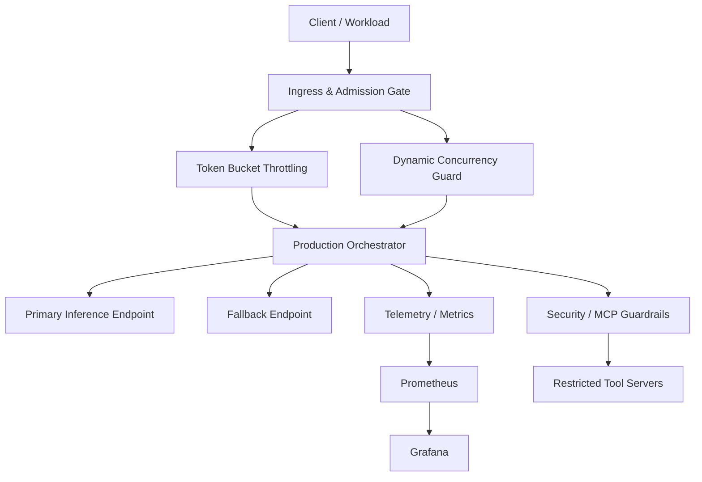

# AI Production Room

A production-grade AI orchestration stack for resilient inference, safety gates, and operational telemetry. This repository blends an incident-investigation application with an enterprise-ready AI runtime architecture: admission control, circuit breakers, fallback routing, OpenTelemetry telemetry, and MCP tool isolation.

## Architecture Overview



## SLIs and Failure Modes

| Failure scenario | Detection mechanism | Mitigation strategy | Recovery time |
| --- | --- | --- | --- |
| Downstream API 429 throttling | Prometheus 4xx / rate-limit counter spike | Fallback to secondary endpoint + dynamic backpressure | < 250 ms |
| Cyclic tool-calling loop | LangGraph iteration cap (N=5) | State-machine circuit-break + human-in-the-loop alert | Immediate |
| Schema parsing failure | Pydantic validation error | Structured retry with corrective system prompt | < 1.2 s |
| Primary endpoint timeout | Circuit-break timeout and latency histogram | Open breaker, route to fallback, backoff with jitter | < 2 s |
| Tool argument injection | MCP schema validation | Reject malformed arguments without crashing loop | < 150 ms |

## Repository Layout

```text
AI-Production-room/
├── .github/
│   └── workflows/
│       ├── ci.yml
│       └── load-test.yml
├── deploy/
│   ├── docker-compose.yml
│   ├── grafana/
│   │   └── dashboards/
│   │       └── ai_slis_dashboard.json
│   └── prometheus/
│       └── prometheus.yml
├── docs/
│   ├── ARCHITECTURE.md
│   └── postmortem-sample.md
├── src/
│   ├── core/
│   │   ├── admission.py
│   │   ├── circuit_breaker.py
│   │   └── orchestrator.py
│   ├── mcp/
│   │   └── servers/
│   └── telemetry/
│       └── metrics.py
├── tests/
│   ├── test_chaos.py
│   └── test_schemas.py
├── backend/
│   └── app/
├── frontend/
├── .gitignore
├── requirements.txt
├── PRESENTATION_DEFENSE.md
├── README.md
└── LICENSE (if present)
```

## Production Enhancements Included

- Resilient request admission with token-bucket throttling and dynamic concurrency gating.
- Circuit breaker with open / half-open / closed transitions and exponential backoff with jitter.
- Structured-output validation and schema-enforced tool calls.
- OpenTelemetry and Prometheus metrics for TTFT, token totals, cost, and breaker state.
- MCP-style isolated tool servers over stdio/SSE boundaries with strict validation.
- Docker Compose setup for app, Redis, Prometheus, and Grafana.
- Example chaos and schema tests for regression coverage.

## Quick Start

### 1) Python environment

```bash
python3 -m venv .venv
source .venv/bin/activate
pip install -r requirements.txt
```

### 2) Run the local service stack

```bash
docker compose -f deploy/docker-compose.yml up --build
```

### 3) Run the tests

```bash
python -m pytest tests -q
```

### 4) Exercise a benchmark

```bash
python - <<'PY'
from src.core.orchestrator import Orchestrator

orchestrator = Orchestrator(
    primary_endpoint='https://primary.example.com/infer',
    fallback_endpoint='https://fallback.example.com/infer',
    max_concurrency=8,
    requests_per_second=12,
)
print(orchestrator)
PY
```

## Benchmark Example

```bash
# start stack
cd deploy && docker compose up -d

# run a synthetic 100-user concurrency probe with a local tool such as k6 or Locust
# k6 run --vus 100 --duration 60s scripts/load.js
# or
# locust -f scripts/locustfile.py --headless -u 100 -r 10 -t 60s
```

## Immediate Actionable Checklist

- [x] Add deploy docker-compose stack with Redis, Prometheus, and Grafana.
- [x] Add metrics for TTFT, token counts, cost, and circuit state.
- [x] Document architecture and recovery state dynamics in docs.
- [x] Add MCP-style tool guardrails and schema validation.
- [x] Add load-test and chaos regression coverage.
- [ ] Pin the repository on the GitHub profile and link it in the resume project section.

## Production Notes

This repository is intentionally designed as a portfolio-grade architecture reference for AI reliability and SRE documentation. It is not intended to be a one-click production deployment for a tri-state model service, but it demonstrates the engineering patterns required to make AI inference systems resilient under failure.

For deeper design reasoning and state-machine specifics, see [docs/ARCHITECTURE.md](docs/ARCHITECTURE.md).
